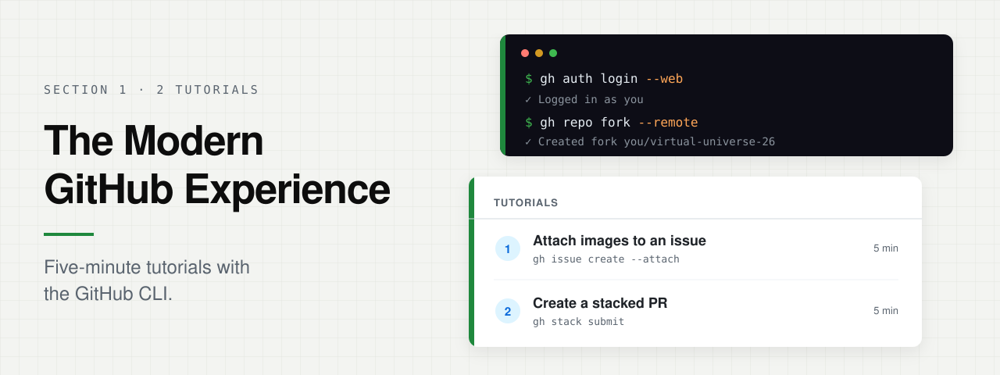

<p align="center">
  
</p>

**Section 1 · 2 tutorials · 5 min each**

In this section you'll learn how to use the GitHub CLI to attach images to an
issue and to create a stacked pull request.

> **Note**
>
> To copy a command, hover over its code block and click the copy button at
> the top right. Paste it into the terminal at the bottom of your Codespace and
> press <kbd>Enter</kbd>. If the terminal isn't open, press
> <kbd>Ctrl</kbd>+<kbd>`</kbd>.

## Getting started

Work in your own fork, so the issues and pull requests you create are yours.
Sign in to GitHub:

```bash
unset GH_TOKEN GITHUB_TOKEN
gh auth login --hostname github.com --git-protocol https --web
```

Finish authorizing in the browser and wait for the terminal prompt to return.
Then create your fork and make it the target for issues and pull requests:

```bash
gh auth setup-git &&
gh repo fork --remote &&
gh repo set-default "$(git remote get-url origin)" &&
gh repo edit --enable-issues
```

Then pick a tutorial. Use this same terminal for both.

1. [Attach images to an issue](attach-images-to-an-issue/README.md): add a screenshot to an issue from the terminal.
2. [Create a stacked PR](create-a-stacked-pr/README.md): split one change into small pull requests that build on each other.

If you're an open source maintainer, check out the
[settings we've shipped to help you manage your project](manage-your-open-source-project/README.md)
and keep AI-generated contributions under control.

[Back to the cookbooks](../README.md)
