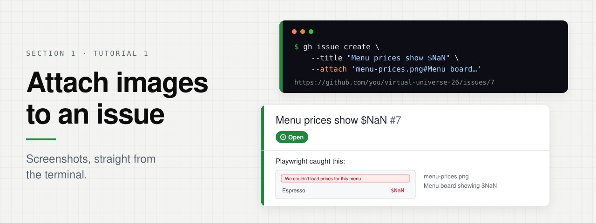
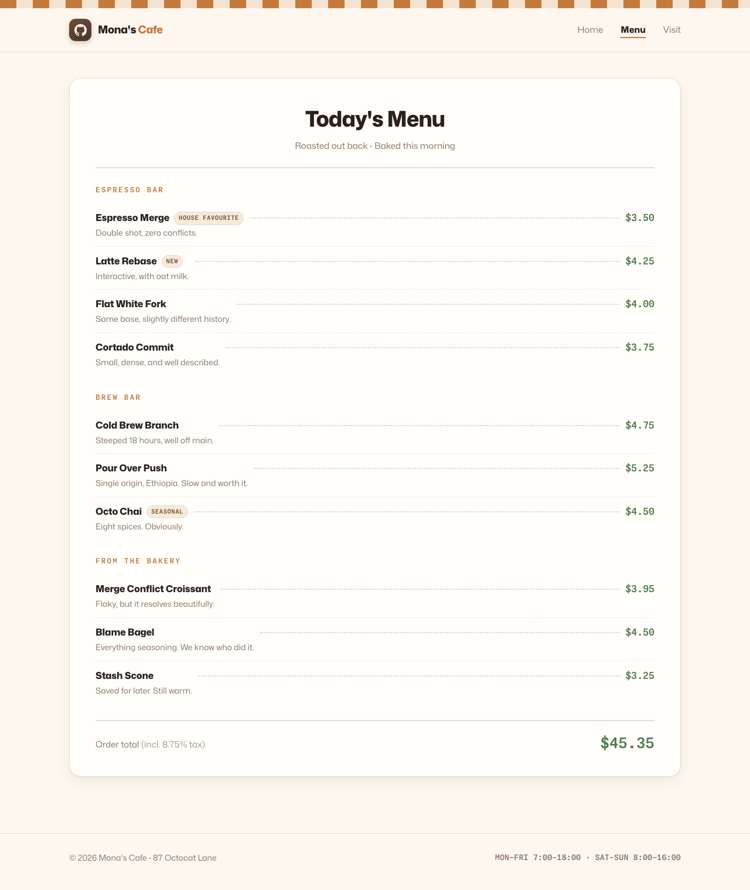

<p align="center">
  
</p>

**Section 1 · Tutorial 1 · 5 min · 3 steps**

Use `--attach` to add a screenshot to an issue, straight from the terminal.

> [!NOTE]
> Mona's café menu has a bug: Playwright caught every price showing `$NaN`.
> You'll file it with the screenshot attached, without leaving the terminal.

## Before you start

To copy a command, hover over its code block and click the copy button at the
top right. Paste it into the terminal at the bottom of your Codespace and press
<kbd>Enter</kbd>. If the terminal isn't open, press <kbd>Ctrl</kbd>+<kbd>`</kbd>.

Skip the rest of this section if you already signed in on the
[Section 1 page](../README.md#getting-started). Otherwise, sign in to GitHub:

```bash
unset GH_TOKEN GITHUB_TOKEN
gh auth login --hostname github.com --git-protocol https --web
```

Finish authorizing in the browser and wait for the terminal prompt to return.
Then create your fork and make it the target for issues and pull requests:

```bash
gh auth setup-git &&
gh repo fork --remote &&
gh repo set-default "$(git remote get-url origin)" &&
gh repo edit --enable-issues
```

## 1. Go to this folder

```bash
cd "$(git rev-parse --show-toplevel)"
cd 01-github-latest-features/attach-images-to-an-issue
```

## 2. Create an issue with the screenshot

The text after `#` is the image's alt text.

```bash
gh issue create \
  --title "Menu prices show \$NaN" \
  --body "Playwright caught this:" \
  --attach 'menu-prices.png#Menu board showing $NaN'
```

## 3. Open your issue

Open the link that `gh` prints. The screenshot is in the issue.

> [!TIP]
> `--attach` also works with `gh issue comment` and `gh pr create`.

## What you'll attach

<p align="center">
  
</p>

<p align="center"><b>menu-prices.png</b> · every price on the menu shows <code>$NaN</code></p>

---

<p align="center">
  <a href="../README.md">← Back to Section 1</a> ·
  <b><a href="../create-a-stacked-pr/README.md">Next: Create a stacked PR →</a></b>
</p>
