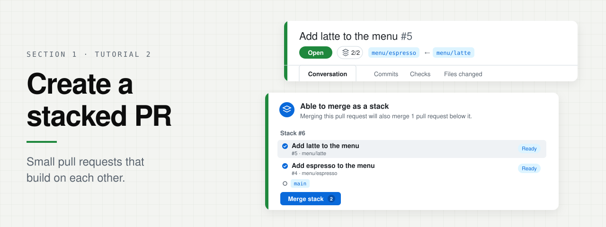
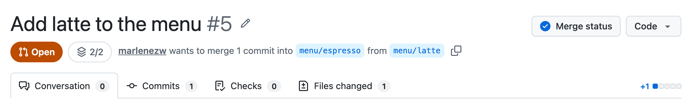
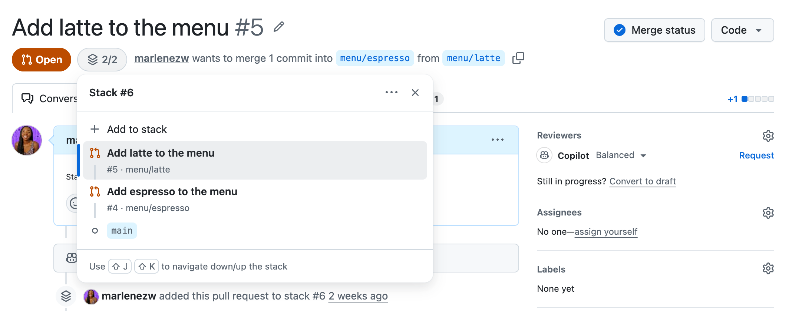
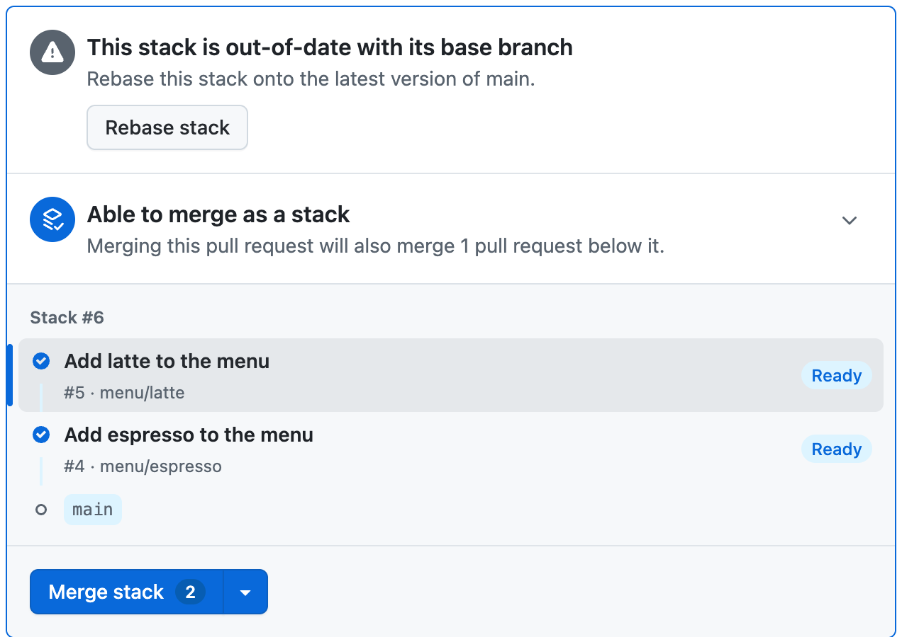

<p align="center">
  
</p>

**Section 1 · Tutorial 2 · 5 min · 5 steps**

Split one change into small pull requests that build on each other, so
reviewers see one layer at a time.

> **Note**
>
> You'll build a two-layer stack for Mona's café menu: espresso first, then
> latte on top. Each layer becomes its own pull request.

## Before you start (skip if you already signed in on Section 1)

To copy a command, hover over its code block and click the copy button at the
top right. Paste it into the terminal at the bottom of your Codespace and press
<kbd>Enter</kbd>. If the terminal isn't open, press <kbd>Ctrl</kbd>+<kbd>`</kbd>.

Sign in to GitHub:

```bash
unset GH_TOKEN GITHUB_TOKEN
gh auth login --hostname github.com --git-protocol https --web
```

Finish authorizing in the browser and wait for the terminal prompt to return.
Then create your fork and make it the target for issues and pull requests:

```bash
gh auth setup-git &&
gh repo fork --remote &&
gh repo set-default "$(git remote get-url origin)" &&
gh repo edit --enable-issues
```

After signing in, follow the steps below by copying and pasting the commands
below into your terminal.

## 1. Go to this folder

```bash
cd "$(git rev-parse --show-toplevel)"
cd 01-github-latest-features/create-a-stacked-pr
```

Set the default repository for regular `gh` commands to your fork:

```bash
gh repo set-default "$(git remote get-url origin)"
gh repo set-default --view
```

## 2. Start a stack, then commit the first change

```bash
gh stack init menu/espresso
echo '- Espresso: $3.00' > menu.md
git add menu.md && git commit -m "Add espresso to the menu"
```

## 3. Add a second branch on top, then commit the next change

```bash
gh stack add menu/latte
echo '- Latte: $4.50' >> menu.md
git commit -am "Add latte to the menu"
```

## 4. Push both branches and open a pull request for each

```bash
GH_REPO="$(git remote get-url origin)" gh stack submit --auto --open --remote origin
```

`GH_REPO` selects the repository for the pull requests; `--remote origin`
selects where the branches are pushed. Both must point to your fork. `--open`
creates the pull requests ready for review instead of as drafts, so the stack
can be merged.

## 5. Open the top of the stack

`gh` prints a link for each pull request. You only need the top one, latte.
Open it on github.com:

```bash
GH_REPO="$(git remote get-url origin)" gh pr view menu/latte --web
```

The latte pull request is based on the espresso branch, so it only shows the
latte change.

<p align="center">
  
</p>

Select the **2/2** stack button next to **Open** to see the whole stack and
jump between its pull requests.

<p align="center">
  
</p>

## What you'll get

Scroll to the bottom of the **Conversation** tab on the top pull request. The
merge box lists every layer in the stack and merges them together.

<p align="center">
  
</p>

<p align="center"><b>Stack #6</b> · latte on top of espresso on top of <code>main</code>, merged in one click</p>

## Troubleshooting

If a previous submit pushed the branches but failed with "Head ref must be a
branch" or "No commits between", or the merge box says **Blocked downstack**
because a pull request is still a draft, run submit again with the explicit
repository override and `--open`. You do not need to recreate the branches
or commits:

```bash
GH_REPO="$(git remote get-url origin)" gh stack submit --auto --open --remote origin
```

---

<p align="center">
  <a href="../attach-images-to-an-issue/README.md">← Attach images to an issue</a> ·
  <b><a href="../README.md">Back to Section 1</a></b>
</p>
