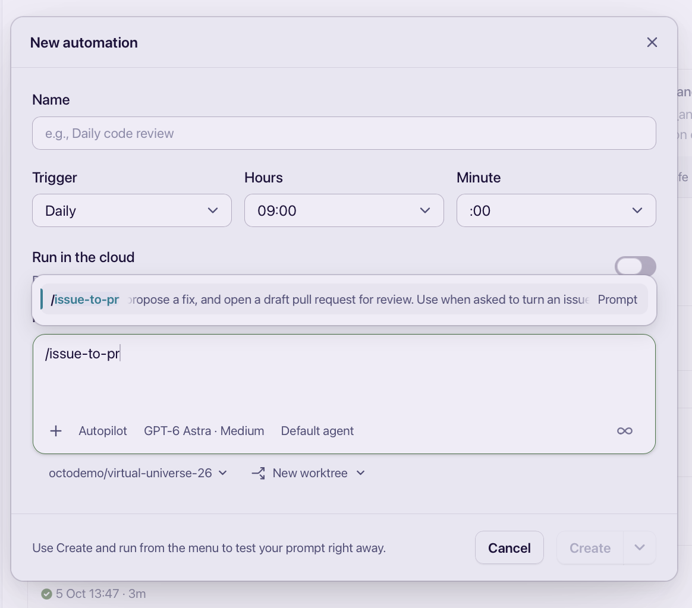

# Turn your skill into an Automation

**Part 4 of 4 · 5 min · 3 steps**

Save your skill as an automation so you can run it again without rewriting the
prompt. You can schedule it for a certain time, but for this tutorial you'll
trigger it manually.

## 1. Create an automation

**Open Automations** in the app sidebar and **click New Automation**.

Give it a name, such as `Issue to PR`. Under **Trigger**, choose **Manual**.
You can choose a scheduled time later.

## 2. Select your project and skill

**Click the project selector** below the prompt box and select **your fork of
virtual-universe-26**, not `octodemo/virtual-universe-26`.



The screenshot shows the event repository and a Daily trigger. For this
tutorial, use **your fork** and **Manual** instead.

**Type `/issue-to-pr`** in the prompt box and select the skill suggestion. Make
sure the selected project has your updated skill.

**Copy this text** after the skill in the automation's prompt box:

```text
Find the oldest open issue in this fork that has no linked pull request and use this skill to propose a fix. Notify me when the PR is ready to be reviewed to be merged.
```

> [!NOTE]
> Selecting the project in the automation form is separate from configuring a
> Git remote.

## 3. Save and run when ready

**Click Create** to save the automation. With a Manual trigger, it won't run
until you start it.

When you're ready, **click the play button** on the automation. Follow its run
and review the draft PR it produces; nothing should merge without your review.

---

You've turned your skill into an automation you can run on demand. Later, you
can give it a schedule.

[← Previous: Security review](../security-review/README.md) · [Back to Section 2](../README.md)
