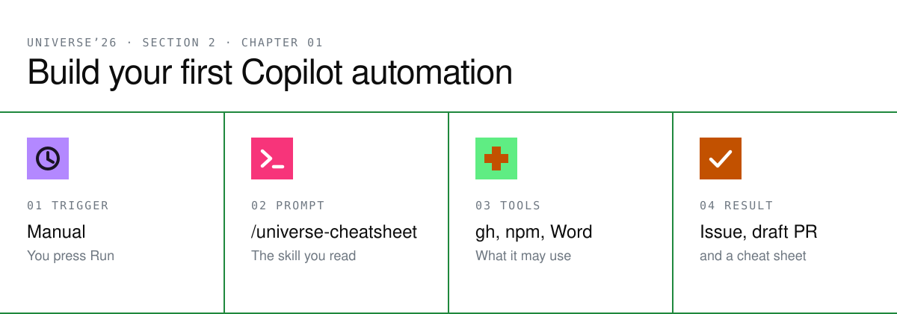

In [Section 1](../../01-github-latest-features/) you created an issue and a pull
request by hand with the GitHub CLI. Here, an automation does it for you.

An **automation** is a saved agent task. It has a **trigger** (when it runs),
a **prompt** (what to do), **tools** (what it may use), and a **result** you review.
Your prompt is a skill: it files an issue asking the note-taker to export a Word
cheat sheet of the keynote highlights, builds the export, opens the cheat sheet in a
Word canvas, and proposes a draft pull request.

## Before you begin

- Fork this repository, clone your fork, and open the clone as a project in the
  GitHub Copilot app.
- Install Node.js and sign in to the GitHub CLI with `gh auth login`.

## 1. Read the skill

Open [`.github/skills/universe-cheatsheet/SKILL.md`](../../.github/skills/universe-cheatsheet/SKILL.md)
in your clone. It lists the `gh` and `npm` commands the agent runs and the rules it follows.

Change one line so the skill works only on your fork:

```diff
- Repository: YOUR-USERNAME/virtual-universe-26
+ Repository: your-username/virtual-universe-26
```

## 2. Create the automation from the skill

1. Select **Automations** in the sidebar.
2. In the skills list, search for `universe-cheatsheet`, then select **New automation**.
   The name and the `/universe-cheatsheet` prompt are filled in for you.
3. Set **Trigger** to **Manual** and keep **Run in the cloud** off.
4. Choose your fork's project and set **Workspace** to **Current checkout**.
5. Select the arrow next to **Create**, then **Create and run**.

## 3. Review the result

Open the run from **Recent runs**. You should see:

- The cheat sheet open in a Word canvas, with the highlights grouped by topic.
- A new issue in your fork: *Export a Word cheat sheet of the keynote highlights*.
- A draft pull request that closes the issue and adds `npm run export:word`.

Read the pull request before you merge it. The automation never merges, approves,
or labels anything.

## Next

Once the manual run looks right, you could change the trigger to run on a schedule
or when an issue is opened. In the next chapter, you customize the agent that does
the work.

[Back to Section 2](../README.md)
