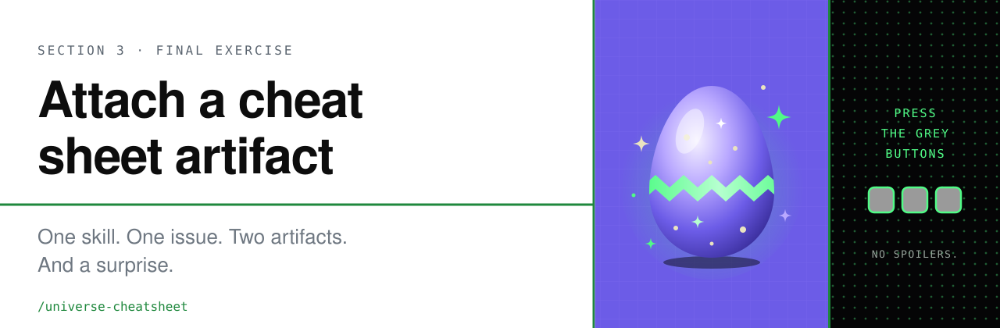

<p align="center">
  
</p>

**Final exercise · 5 min · 3 steps**

You're almost done with the workshop! To bring everything you learned together
you will create an Issue Artifact.

> [!NOTE]
> **Issue Artifacts** let you attach rich, structured artifacts; implementation
> plans, research and investigation notes, design docs, images and reference
> links — directly to a GitHub issue. Instead of important context living in
> scattered comments or external tools.

In this section we will use the GitHub CLI and Copilot skills to attach an
image with a cheatsheet of the top updates we covered in the Virtual Universe
practical sessions.

## 1. Find the skill

In the Copilot app, run:

```text
/skills list
```

Look for `universe-cheatsheet`. It's already in this repository at
[`.github/skills/universe-cheatsheet/`](../../.github/skills/universe-cheatsheet/SKILL.md),
so there's nothing to install.

## 2. Run the skill

```text
/universe-cheatsheet create an issue artifact with the cheat sheet
```

Copilot will:

- 📖 read the [recap](../github-universe-recap/) and [cheat sheet](../github-universe-cheat-sheet/) pages
- 🎨 design a one-page cheat sheet in the Universe theme and save it as an image
- 🥚 make a surprise card image
- 🗂️ open a session from that issue and use `/create-issue-artifact` to add both images as artifacts

## 3. Open your issue

Open the issue link that Copilot gives you. Read the surprise card to see an
easter egg we've left for you in your
[Virtual GitHub Universe Badge](https://leereilly.net/badger.github.io/virtual/).

## What you'll get

<p align="center">
  
</p>

<p align="center"><b>Artifact 1</b> · your cheat sheet &nbsp;·&nbsp; <b>Artifact 2</b> · a surprise you'll only see once you run the skill ✨</p>

---

<p align="center">
  🎉 <b>That's the end of the workshop.</b> Thanks for building with us!<br><br>
  <a href="../README.md">← Back to Section 3</a> ·
  <a href="../github-universe-recap/">Universe recap</a>
</p>
