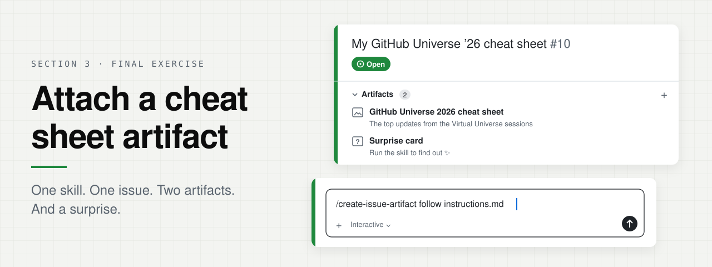
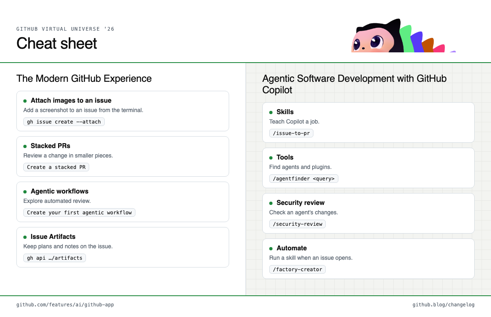

<p align="center">
  
</p>

**Final exercise · 5 min · 3 steps**

You're almost done with the workshop! To bring everything you learned together
you will create an Issue Artifact.

> **Issue Artifacts** let you attach rich, structured artifacts; implementation
> plans, research and investigation notes, design docs, images and reference
> links — directly to a GitHub issue. Instead of important context living in
> scattered comments or external tools.

In this section you'll use the `/create-issue-artifact` skill to attach a
cheat sheet of the top updates from the Virtual Universe practical sessions to
an issue.

## 1. Open an issue session

In your fork, ask Copilot:

```text
Create an issue titled "My GitHub Universe '26 cheat sheet" and open a session for it
```

Switch to the new session since `/create-issue-artifact` attaches to the issue
linked to the session you run it in.

## 2. Run the skill

```text
/create-issue-artifact follow github-virtual-universe-highlights/attach-a-cheat-sheet-artifact/instructions.md
```

Copilot reads [the instructions](instructions.md), then:

- reads the [recap](../github-universe-recap/) and [cheat sheet](../github-universe-cheat-sheet/) pages
- designs a one-page cheat sheet in the Universe theme
- makes a ✨surprise card✨
- adds both images to your issue as artifacts

## 3. Open your issue

Open the issue and select **Artifacts**. Read the surprise card to see an
easter egg we've left for you in your
[Virtual GitHub Universe Badge](https://leereilly.net/badger.github.io/virtual/).

## What you'll get

<p align="center">
  
</p>

<p align="center"><b>Artifact 1</b> · your cheat sheet &nbsp;·&nbsp; <b>Artifact 2</b> · a surprise you'll only see once you run the skill ✨</p>

---

<p align="center">
  🎉 <b>That's the end of the workshop.</b> Thanks for building with us!<br><br>
  <a href="../README.md">← Back to Section 3</a> ·
  <a href="../github-universe-recap/">Universe recap</a>
</p>
